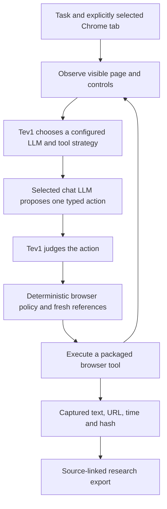

# JEV Browser

An open-source Chrome side-panel agent with local decision-model routing. Give it a task on a selected tab, watch the real page change, and inspect the model route, action journal and captured sources.

**Experimental developer release.** This is an independent project. TypeSafe, Together AI, Ollama, Google and Anthropic do not sponsor or endorse it. The MIT license covers this extension code; each model retains its own license.

## How it works



TypeSafe's [Jev 1.14](https://docs.typesafe.ai/models) is a decision model. [Together AI's Tev1](https://ollama.com/library/tev1) is a separate experimental Jev-inspired decision model available through Ollama. This release uses local Tev1 through `/v1/systemone`; it does not include TypeSafe's model weights or call its hosted API. The decision model selects registered choices and reviews actions; a configured chat LLM proposes the action arguments.

The extension supports public web search, observed links, clicking, paced DOM typing into public GET search forms, selected keys, controlled back navigation and source extraction. All tools are packaged code. It never executes generated JavaScript or model-provided selectors. Web search uses an editable provider URL from Settings, with a default public search endpoint and no search API key.

## Install locally

1. Install Chrome and Ollama. The local System One endpoint requires Ollama 0.35 or newer; this project was checked with Chrome 155 and Ollama 0.40.2.
2. Install the configured models. Defaults are `tev1:4b` for decisions and `qwen3.8:latest` for both chat-model tiers, following the project owner's selection. You can configure different compatible local chat models for the two routing tiers in Settings.
3. Open `chrome://extensions`, enable Developer mode, choose **Load unpacked**, and select this folder containing `manifest.json`.
4. Copy the extension ID from its card. Configure Ollama to allow that exact extension origin, following the [Ollama FAQ](https://docs.ollama.com/faq). When running Ollama from a terminal, the origin setting is `OLLAMA_ORIGINS=chrome-extension://YOUR_EXTENSION_ID`. Restart your Ollama service with that setting. Preserve any other explicitly trusted origins already required by your setup.
5. Pin JEV Browser, open a public website, and click the extension icon. In Settings, check the endpoint and model choices, then choose **Check models**.
6. Enter a task and select **Start on this tab**. Use **Allow this website** when a site grant is needed. Stop ends inference and disconnects the execution channel. Reopening the panel marks unfinished work interrupted; actions are never replayed automatically.

The extension accepts only loopback Ollama endpoints and rejects models advertised as remote/cloud-backed. The endpoint defaults to the standard local Ollama service. No Python backend, API key or npm runtime dependency is required.

## Try it

Start on the Python documentation and ask:

> Type asyncio into Quick search, click Go, then go back to the starting page and capture its overview. Finish after the evidence is collected.

For job research:

> Find senior AI/backend roles in Israel. Search indexed listings, read accessible employer career pages, and capture the role title, location and source text. Keep details that are missing marked unknown. Stop at login, challenge or application steps.

LinkedIn and Glassdoor may require sign-in or restrict automated access. See their [LinkedIn policy](https://www.linkedin.com/help/linkedin/answer/a1340567/automated-activity-on-linkedin?lang=en) and [Glassdoor terms](https://www.glassdoor.com/about/terms/). Search discovery and accessible employer pages are supported paths; unrestricted automation of those boards is not promised. This release does not submit applications, messages, uploads or account changes.

## Data and permissions

- `activeTab` binds access to a tab you explicitly invoke. Runs stay pinned to that tab; switching tabs does not retarget them.
- Additional site access is optional and requested for an exact origin through a user gesture. A cross-origin navigation can require a new grant.
- The model loop runs in the panel. Its service worker only handles short Chrome events.
- Model requests go to the configured local Ollama endpoint. No analytics or remote scripts are included.
- Settings stay in trusted local extension storage. Bounded run checkpoints remain in trusted session storage. Captures leave that session only when you export them or choose to transmit them through another tool.
- Credentials, sensitive controls and consequential actions are excluded from the available tools. Page content remains untrusted. Existing-tab interaction does not provide a network sandbox against arbitrary website JavaScript.
- Typing uses DOM input events. Canvas interfaces, browser chrome, native dialogs and sites requiring trusted hardware input are outside this version's control surface.

The research export contains captured page excerpts and their sources. A capture does not establish that a job is still open or that its requirements fit a particular candidate.

## Development and verification

Node 26+ runs the dependency-free model/controller tests:

```sh
npm test
npm run check
```

Real DOM fixtures use Python, pytest and Playwright:

```sh
python -m pip install pytest playwright
python -m playwright install chromium
python -m pytest -q tests
```

The parent JEV workspace also includes this extension in `.claude/docs-first/verify.sh`. Mocked model checks, real DOM fixtures and live-model evaluations are reported separately. No single example establishes reliable behavior on every website.

The source folder is a standalone GitHub publication unit. Do not copy `.env`, local browser profiles, research history, credentials, or the parent workspace's outputs into a public repository.
