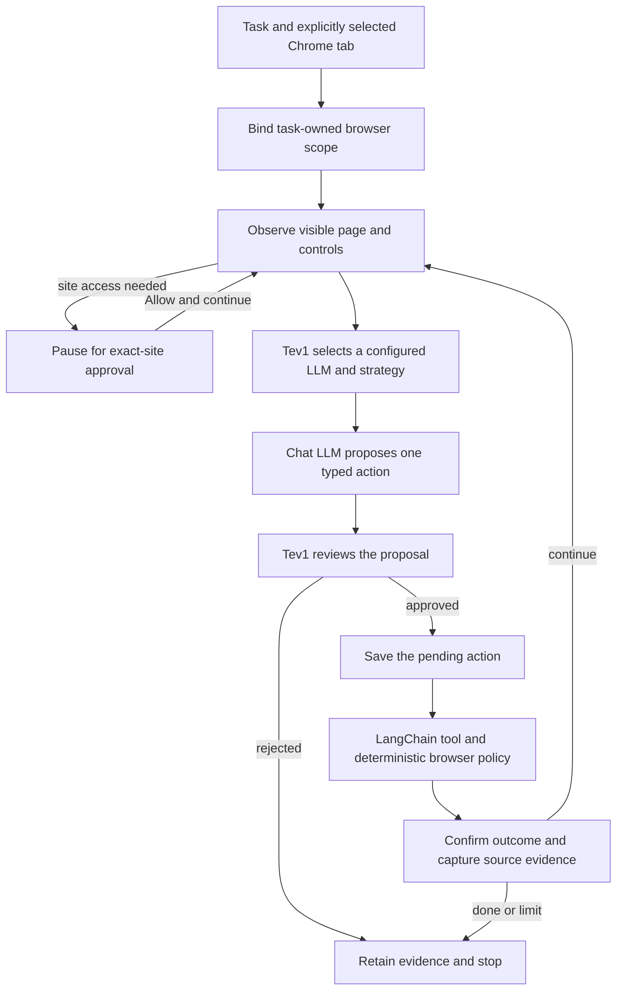

# Ollama Copilot

An open-source Chrome side-panel agent built with LangChain Core and LangGraph.js, using local Ollama models. Give it a task on a selected tab, watch the real page change, and inspect the model route, action journal and captured sources.

**Experimental developer release.** This is an independent project. TypeSafe, Together AI, Ollama, Google and Anthropic do not sponsor or endorse it. The MIT license covers this extension code; each model retains its own license.

## How it works



LangGraph owns the nodes, state and conditional loop. An in-memory checkpointer and native checkpoint breakpoint preserve a mission while it waits for exact-site approval; the explicit continue action resumes that same graph and observes the page again. Confirmed browser actions are not replayed. This uses the pinned web build's documented static breakpoint and null-input continuation; its dynamic interrupt API requires async context that this browser build does not provide. LangChain structured tools execute reviewed browser actions through the packaged Chrome driver. The model adapter retains bounded direct requests to local Ollama. Framework code is bundled into the extension; there is no orchestration backend, relay proxy or hosted LangGraph service.


TypeSafe's [Jev 1.14](https://docs.typesafe.ai/models) is a decision model. [Together AI's Tev1](https://ollama.com/library/tev1) is a separate experimental Jev-inspired decision model available through Ollama. This release uses local Tev1 through `/v1/systemone`; it does not include TypeSafe's model weights or call its hosted API. The decision model selects registered choices and reviews actions; a configured chat LLM proposes the action arguments.

The extension supports public web search, observed links, clicking, paced DOM typing into public GET search forms, selected keys, controlled back navigation, task-owned new tabs and source extraction. All tools are packaged code. It never executes generated JavaScript or model-provided selectors. Web search uses an editable provider URL from Settings, with a default public search endpoint and no search API key.

## Install locally

1. Install Chrome and Ollama. The local System One endpoint requires Ollama 0.35 or newer; this project was checked with Chrome 155 and Ollama 0.40.2.
2. Install the configured models. Defaults are `tev1:4b` for decisions and `qwen3.8:latest` for both chat-model tiers, following the project owner's selection. You can configure different compatible local chat models for the two routing tiers in Settings.
3. From this source folder, run `npm ci` and `npm run build` to create the local browser bundle. A prepared download already contains that bundle.
4. Open `chrome://extensions`, enable Developer mode, choose **Load unpacked**, and select this folder containing `manifest.json`.
5. Copy the extension ID from its card. Configure Ollama to allow that exact extension origin, following the [Ollama FAQ](https://docs.ollama.com/faq). When running Ollama from a terminal, the origin setting is `OLLAMA_ORIGINS=chrome-extension://YOUR_EXTENSION_ID`. Restart your Ollama service with that setting. Preserve any other explicitly trusted origins already required by your setup.
6. Pin Ollama Copilot, open a public website, and click the extension icon. In Settings, check the endpoint and model choices, then choose **Check models**.
7. Enter a task and select **Start on this tab**. Use **Allow and continue** if an ongoing task pauses at a new website. This grants access only to the displayed origin and lets the same mission make its next decision. **Allow this website** is also available before starting. Stop ends inference and disconnects the execution channel. Closing or reopening the panel interrupts unfinished work; its saved evidence remains viewable, but executable ownership is not restored and actions are never replayed automatically.

If a page redirects and Chrome hides its new address, Copilot keeps the mission waiting. Click its toolbar icon on the visible page, select **Review current website**, check the displayed public origin, then select **Allow and continue**. That explicit review authorizes the current page; Copilot observes it again before deciding what to do next. A denied request, changed task ownership, Stop or panel reload cannot silently resume browser actions.

The extension accepts only loopback Ollama endpoints and rejects models advertised as remote/cloud-backed. The endpoint defaults to the standard local Ollama service. No Python backend, API key or separate Node server is required after the extension is built.

## Connection boundaries

The extension connects directly to the configured loopback Ollama endpoint. It does not configure a system or browser proxy, change DNS/VPN settings, or send model requests through OpenAI or LangSmith. An HTTP 403 from Ollama means the extension origin is not allowed; preserve existing trusted origins when adding the exact ID. If another application or this chat uses Ollama, leave it running and arrange any required restart when that work is finished.

## Try it

Start on the Python documentation and ask:

> Type asyncio into Quick search, click Go, then go back to the starting page and capture its overview. Finish after the evidence is collected.

For job research:

> Find a senior AI or backend engineering job in Israel and research its location and requirements from the employer's career page. Capture the source for the result.

Start on a blank search page. This goal leaves the query, employer and browsing decisions to the model. Chrome may still need your approval for a newly encountered website; approving access does not choose a job for the model.

LinkedIn and Glassdoor may require sign-in or restrict automated access. See their [LinkedIn policy](https://www.linkedin.com/help/linkedin/answer/a1340567/automated-activity-on-linkedin?lang=en) and [Glassdoor terms](https://www.glassdoor.com/about/terms/). Search discovery and accessible employer pages are supported paths; unrestricted automation of those boards is not promised. This release does not submit applications, messages, uploads or account changes.

## Data and permissions

- `activeTab` binds access to a tab you explicitly invoke. A run starts on that tab and can open an observed public reading link in a new task-owned tab. It can switch only among its own recorded tabs; unrelated user tabs remain outside the run.
- Additional site access is optional and requested for an exact origin through a user gesture. A cross-origin navigation can require a new grant. Only a safe observation-time access pause can be continued in the same open panel; uncertain actions and ownership changes cannot be resumed.
- The LangGraph workflow runs in the visible panel. Its service worker only handles short Chrome events. Stop aborts model work and closes the execution channel; completed tab actions are never retried automatically.
- Model requests go to the configured local Ollama endpoint. No analytics or remote scripts are included.
- Settings stay in trusted local extension storage. Bounded run checkpoints remain in trusted session storage. Captures leave that session only when you export them or choose to transmit them through another tool.
- Credentials, sensitive controls and consequential actions are excluded from the available tools. Page content remains untrusted. Existing-tab interaction does not provide a network sandbox against arbitrary website JavaScript.
- Typing uses DOM input events. Canvas interfaces, browser chrome, native dialogs and sites requiring trusted hardware input are outside this version's control surface.

The research export contains captured page excerpts and their sources. A capture does not establish that a job is still open or that its requirements fit a particular candidate.

## Development and verification

Node 26+ builds the bundled framework code and runs the model/controller tests:

```sh
npm ci
npm run build
npm test
npm run check
```

Real DOM fixtures use Python, pytest and Playwright:

```sh
python -m pip install pytest playwright
python -m playwright install chromium
python -m pytest -q tests
```

The parent research workspace also includes this extension in `.claude/docs-first/verify.sh`. Mocked model checks, real DOM fixtures and live-model evaluations are reported separately. No single example establishes reliable behavior on every website.

The source folder is a standalone GitHub publication unit. Do not copy `.env`, local browser profiles, research history, credentials, or the parent workspace's outputs into a public repository.
